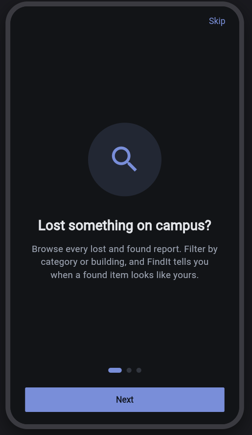
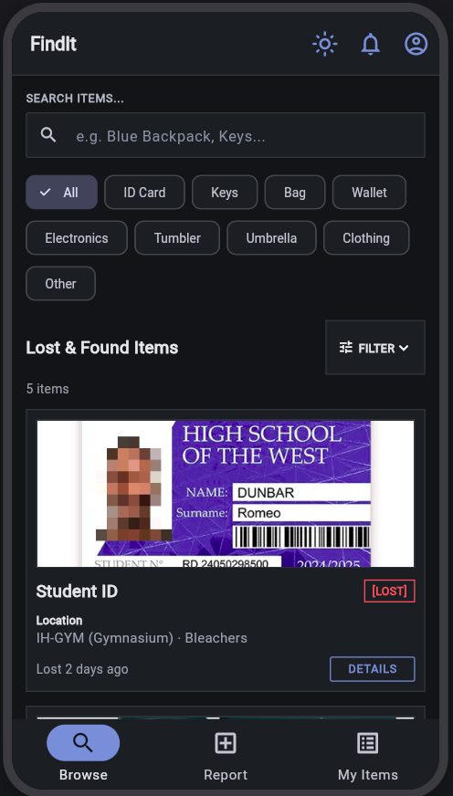
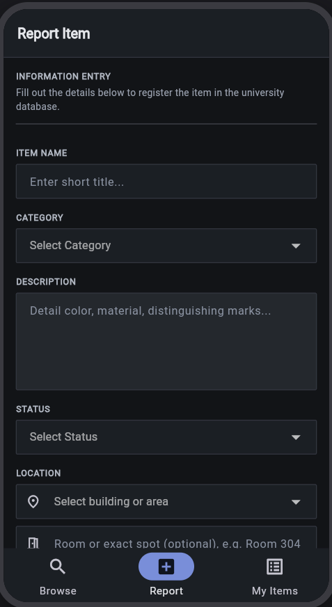
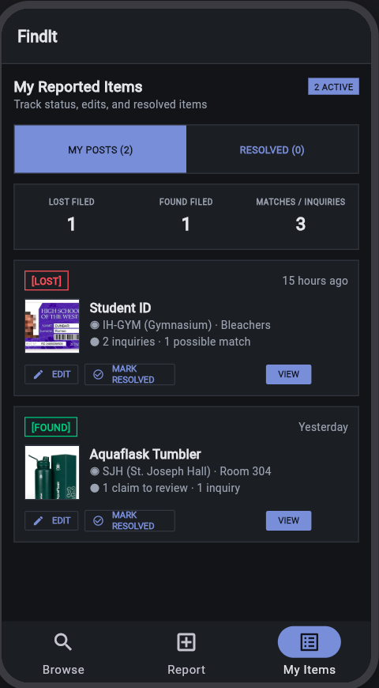
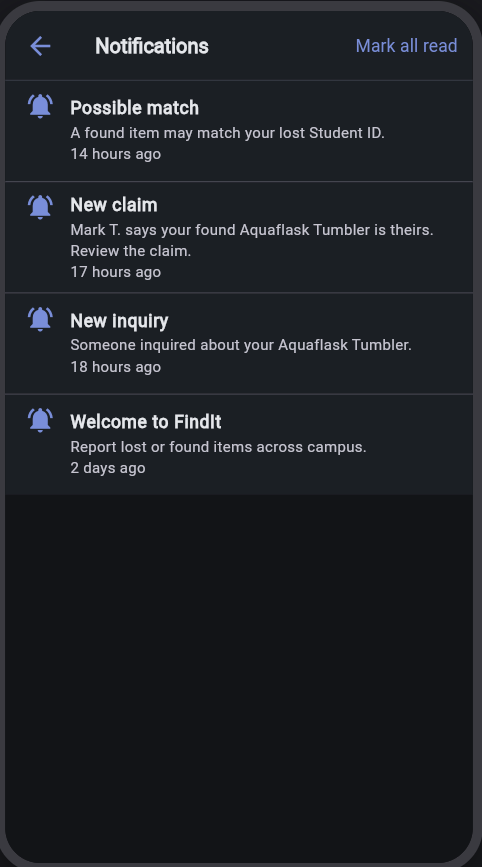
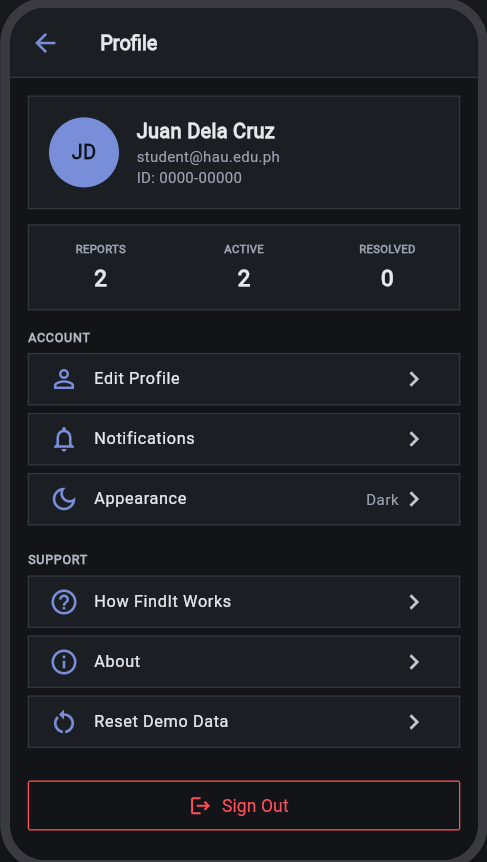
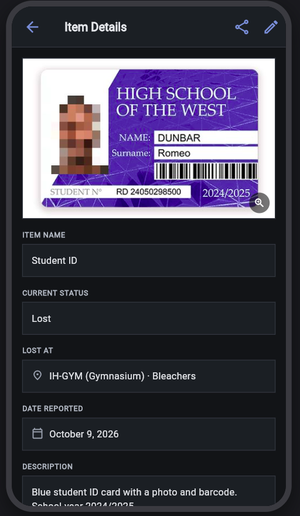
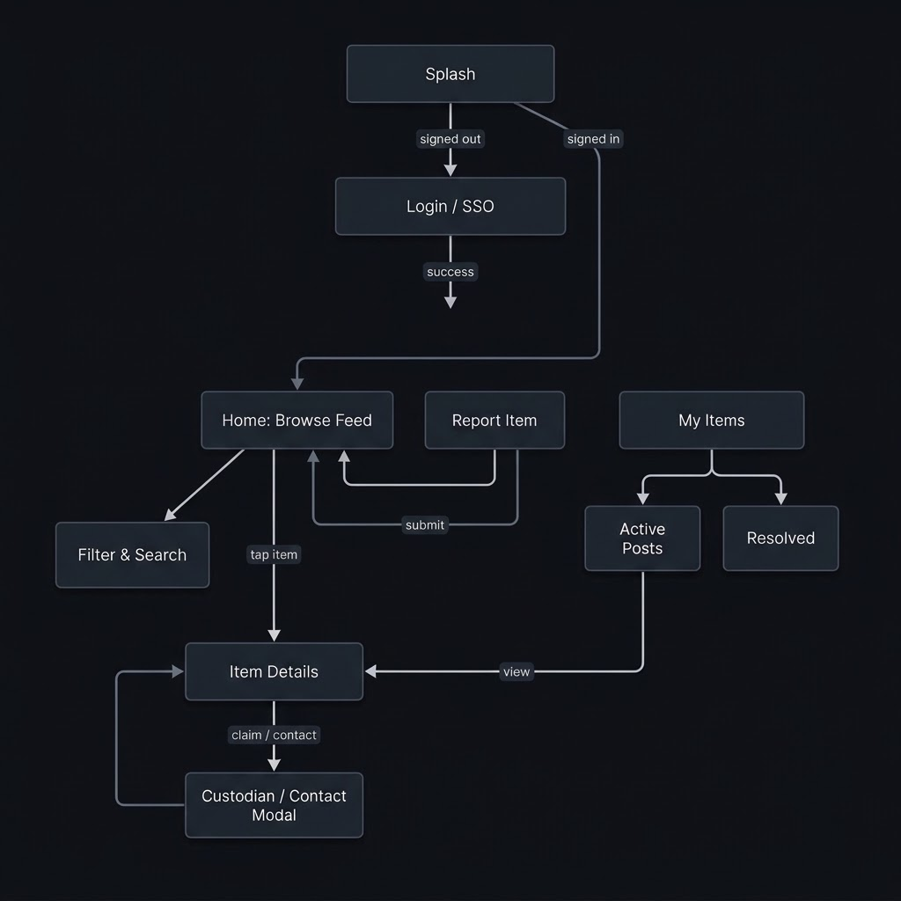

# Mockup and wireframes

## Mockup

 
  

 
  
  
  

 
  
  
  

## Wireframes

 
  

## Screens

### 1. Opening Screen
The opening screen introduces FindIt with a short message explaining its purpose. The user can tap Next to proceed through the introduction and eventually enter the main app.

### 2. Browse Screen
The Browse screen displays lost and found items, including their photos, names, and basic details. Users can search for items using the search bar, filter listings by category, or select an item to open its details. The bottom navigation allows users to open the Browse, Report, and My Items screens.

### 3. Report Item Screen
This screen contains a form for reporting a lost or found item. Users can enter the item's title, category, description, location, and other relevant details, then submit the report. The bottom navigation allows them to return to Browse or view their My Items screen.

### 4. My Items Screen
This screen displays the user's reported items, with options to view different item statuses and review individual reports. Selecting an item opens its details. Users can also return to Browse or open the Report screen through the bottom navigation.

### 5. Item Details Screen
This screen displays the selected item's photo, title, category, location, description, and other available information. Users can review the listing, use the available edit or more-options controls, and return to the previous screen using the back arrow.

### 6. Notifications Screen
The Notifications screen displays updates such as possible item matches, new claims, and other item-related activity. Users can select a notification to review the related information or use Mark all as read to clear unread indicators.

### 7. Profile Screen
The Profile screen displays the user's profile information, item statistics, and account-related options. Users can access their reported items, notifications, app settings, and other available options. The Log Out button allows them to leave their account.
