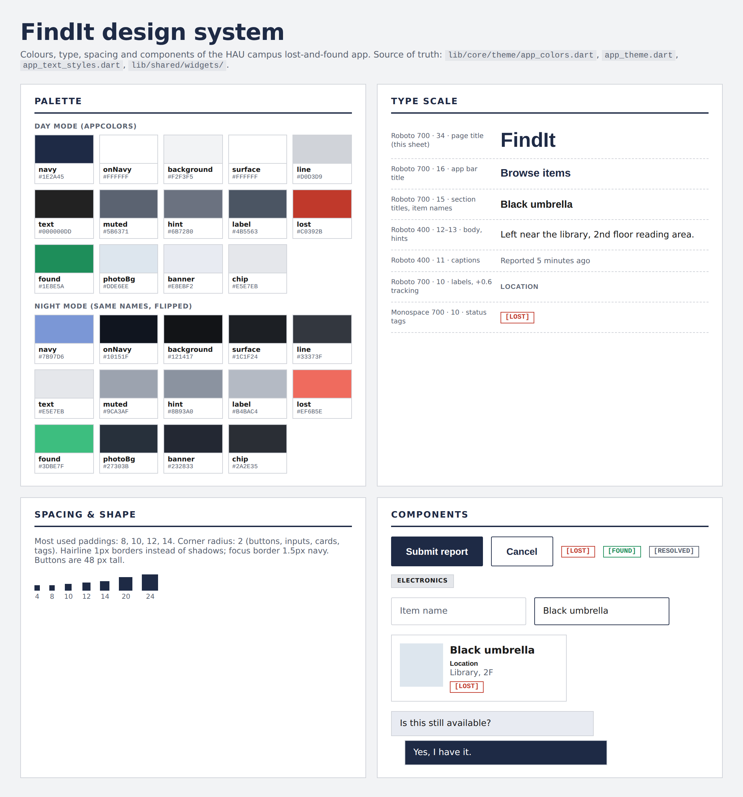

# Design system

FindIt is a campus lost-and-found app, so the look is plain and square: navy on light grey, thin borders, 2 px corners and no shadows. Lost and found items are told apart by colour and a bracketed tag (`[LOST]`, `[FOUND]`), never by colour alone.

Source of truth: `lib/core/theme/app_colors.dart`, `app_theme.dart`, `app_text_styles.dart` and `lib/shared/widgets/`.

## Palette

Every screen reads its colours from `AppColors` while it builds, so switching night mode repaints the whole app with the same names.

| Name | Day | Night | Used for |
| :--- | :--- | :--- | :--- |
| `navy` | `#1E2A45` | `#7B97D6` | brand colour: buttons, selected states, icons, titles |
| `onNavy` | `#FFFFFF` | `#10151F` | text and icons on `navy` (buttons, selected tabs, avatars) |
| `background` | `#F2F3F5` | `#121417` | screen backgrounds |
| `surface` | `#FFFFFF` | `#1C1F24` | cards, inputs, app bar, sheets |
| `line` | `#D0D3D9` | `#33373F` | borders and dividers |
| `text` | `#000000DD` | `#E5E7EB` | main text |
| `muted` | `#5B6371` | `#9CA3AF` | secondary text, captions |
| `hint` | `#6B7280` | `#8B93A0` | input hints |
| `label` | `#4B5563` | `#B4BAC4` | field labels |
| `lost` | `#C0392B` | `#EF6B5E` | `[LOST]` tags, errors |
| `found` | `#1E8E5A` | `#3DBE7F` | `[FOUND]` tags |
| `photoBg` | `#DDE6EE` | `#27303B` | empty photo area |
| `banner` | `#E8EBF2` | `#232833` | info banners, received chat bubbles |
| `chip` | `#E5E7EB` | `#2A2E35` | category chips |

## Type scale

One font family, **Roboto**, set once in `AppTheme.font`. The only other face is the system monospace, used for status tags.

| Style | Font | Size | Used for |
| :--- | :--- | :--- | :--- |
| App bar title | Roboto 700 | 16 | screen headers |
| Section title / item name | Roboto 700 | 15 | `sectionTitle`, item card names |
| Body | Roboto 400 | 12 to 13 | most text, read-only fields |
| Caption | Roboto 400 | 11 | when an item was reported, photo placeholder |
| Label | Roboto 700, +0.6 tracking | 10 | field labels, small buttons |
| Chip | Roboto 700, +0.5 tracking | 9 | category chips |
| Status tag | Monospace 700 | 10 | `[LOST]`, `[FOUND]`, `[RESOLVED]` |

## Spacing

- Most used paddings: 8, 10, 12, 14 (`EdgeInsets.all(12)` is the most common).
- Corner radius: 2 for buttons, inputs, cards and tags. Borders are 1 px `line`; a focused input gets a 1.5 px `navy` border.
- Buttons are 48 px tall, full width. Small card buttons are 30 px tall.

## Components

One row per reusable widget: what it is, which file it lives in, what parameters it takes, which screens use it.

| Widget | File | Parameters | Used on |
| :--- | :--- | :--- | :--- |
| `ItemCard` | `item_card.dart` | `item`, `onDetails`, `heroTag` | Home |
| `ItemPhoto` | `item_photo.dart` | `item`, `height`, `emptyLabel`, `zoomable`, `heroTag` | Item details, Claim, item cards |
| `StatusTag` | `status_tag.dart` | `item` | item cards, Item details, My items |
| `ChipTag` | `chip_tag.dart` | `text` | Item details |
| `FieldLabel` | `field_label.dart` | `text` | Login, Register, Forgot password, Report, Edit profile, Profile, Claim, Item details |
| `ReadOnlyField` | `read_only_field.dart` | `text`, `icon`, `minHeight` | Edit profile, Item details |
| `EmptyState` | `empty_state.dart` | `message`, `title`, `actionLabel`, `actionIcon`, `onAction` | Home, My items, Notifications, Chat |
| `FadeSlideIn` | `fade_slide_in.dart` | `child`, `index` | Home, My items, empty states |
| `PhoneFrame` | `phone_frame.dart` | `child` | the whole app (web demo) |
| `MyItemCard` | `my_items/widgets/my_item_card.dart` | `item` | My items |
| `StatsRow` | `my_items/widgets/stats_row.dart` | | My items |
| `ClaimStatusCard` | `claim/widgets/claim_status_card.dart` | | Item details (visitor) |
| `MessageBubble` | `chat/widgets/message_bubble.dart` | `message` | Chat |
| `MessageInput` | `chat/widgets/message_input.dart` | | Chat |
| `NotificationTile` | `notifications/widgets/notification_tile.dart` | | Notifications |

## Changes since the last version

- 2026-10-05: Added night mode: the same colour names, flipped (`AppColors.dark`, set through `ThemeController`).
